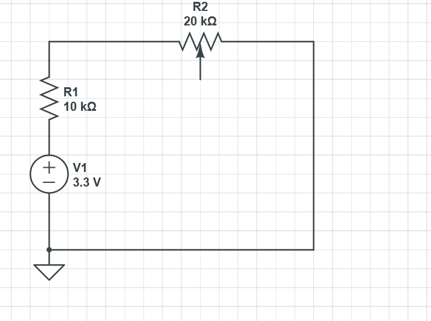

## Proposal (SPI)
- Use basys3
- Sequential + combinational logic
- SPI controller to interface with MAX3008 ADC chip on breadboard
- Make the SPI FSM by HAND
- Pass in value, store it in register?
- Get value, and output to BCD display as voltage

## Analog Circuit Testing Design
- Arduino to output voltage
- Potentiometer to adjust voltage levels using voltage divider

## Digital System Design
- SPI FSM
- Voltmeter Module
### SPI FSM
- 
-
-

### Voltmeter FSM
-
-
- 

### Things to Fix?
- Rounding (The Voltmeter only truncates, does not round)
- Ammeter could potentially be developed?
- Oscilloscope could also potentially be developed (after VGA lab or UART library is developed for a diff project)

## DEMO!

